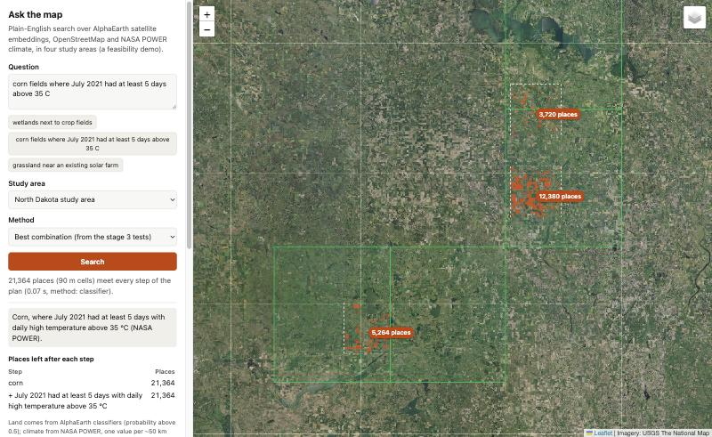

# Ask the Map

Ask plain-English questions about land and climate, such as *"corn fields where July 2021 had at least 5 days
above 35 °C"*, *"wetlands more than 500 m from any cropland"* or *"forest within 500 m of a solar farm"*, and
get the answer as a map.

The answers combine three free resources:

- **[AlphaEarth](https://deepmind.google/discover/blog/alphaearth-foundations-helps-map-our-planet-in-unprecedented-detail/)
  satellite embeddings** (Google DeepMind, via Earth Engine), which tell the land apart: crops, grassland,
  wetland, forest, solar farms;
- **[NASA POWER](https://power.larc.nasa.gov/)** daily climate data, which checks weather conditions as numbers;
- an **open language model** (`openai/gpt-oss-120b`, via the Hugging Face router), which turns the question into
  a small structured plan.

Three ways of answering are compared, side by side, in four US study areas (North Dakota, North Carolina, and the
held-out Minnesota and Georgia):

| Method | Land | Climate | Distances |
|---|---|---|---|
| **1. Aligning text and satellite embeddings** (the [AETHER](https://arxiv.org/abs/2610.23110) recipe) | text and AlphaEarth embeddings trained into one shared space | as words, in the same space | geometry on the shared space's own land map |
| **2. The same, with NASA POWER for climate** | the shared space | NASA POWER's daily numbers | geometry |
| **3. A classifier with an AI planner** | one small classifier on AlphaEarth embeddings | NASA POWER's daily numbers | geometry |

On the 40 questions in states the models never saw in training, Methods 2 and 3 are level (median F1 0.58 and
0.56, or 0.64 with the context land model the demo uses), and both score two and a half times what the same
shared space gets when the climate and distances go in as words (0.23). That 0.23 is our Method 1, AETHER's
recipe trained on our captions, not AETHER's published results, which are on a different task. Checking climate
against the numbers and measuring distances with geometry are what make the difference. Every result comes from the notebooks in this
repository, and `outputs/results/` holds what they produced.



## Contents

- [Quick start](#quick-start)
- [Accounts and credentials](#accounts-and-credentials)
- [The demo](#the-demo) and [hosting it](#hosting-the-demo)
- [The pipeline](#the-pipeline)
- [How it works](#how-it-works)
- [Repository layout](#repository-layout)
- [Development](#development)
- [Data, models and licences](#data-models-and-licences)

## Quick start

Requirements: Python 3.12, [uv](https://docs.astral.sh/uv/), about 7 GB of disk for data and 2 GB for model
downloads, and a Mac or Linux machine (the models were trained on a Mac mini; Apple's MPS is used when present,
otherwise the CPU).

```bash
git clone https://github.com/dividor/ask-the-map-demo.git
cd ask-the-map-demo
uv sync                      # installs the project and the development tools into .venv
cp .env.example .env         # then edit .env (see the next section)
uv run python scripts/check_setup.py   # checks the data folder, the Hugging Face login and Earth Engine
```

Then either build everything with `scripts/run_pipeline.sh` (a few hours, see [The pipeline](#the-pipeline)) and
start the demo with `uv run python -m askmap.demo.serve`.

## Accounts and credentials

`.env` holds three settings (`.env.example` explains each). It is ignored by git.

| Setting | What it is | Needed for |
|---|---|---|
| `ASKMAP_DATA_ROOT` | a folder for every download and built file | everything |
| `EE_PROJECT` | your Google Cloud project ID, registered for Earth Engine | building the land tiles (notebooks 01, 15b, 23) |
| `HF_HOME` | a folder for the Hugging Face model cache | the text encoders (notebooks 11 onwards, and the demo) |

### Google Earth Engine (for the satellite data)

Earth Engine is free for noncommercial use. You need a Google account, a Cloud project registered for Earth
Engine with the Earth Engine API enabled, the `gcloud` command-line tool, and one login:

```bash
gcloud auth application-default login
```

**[docs/earth_engine.md](docs/earth_engine.md) walks through every step**, including the registration page, what
to put in `.env`, how to check it works, quotas, and the common errors. The project ID is never printed.

### Hugging Face (for the language model and the text encoders)

1. Create a free account at <https://huggingface.co> and a token with the *inference* permission
   (**Settings → Access Tokens**).
2. Log in once: `hf auth login` (or set `HF_TOKEN` in your shell). The token is read from the login file or the
   variable; it is never written into this repository.
3. The language model (`openai/gpt-oss-120b`) runs on Hugging Face's
   [Inference Providers](https://huggingface.co/docs/inference-providers): a free account has a small monthly
   credit, and a PRO account (about $9 a month) covers the full pipeline comfortably. Replies are saved under
   `outputs/llm/`, and saved replies are reused, so rerunning a notebook does not ask the model again.
4. The two text encoders (`openai/clip-vit-large-patch14` and `Qwen/Qwen3-Embedding-0.6B`) are downloaded into
   `HF_HOME` at pinned commits on first use.

### NASA POWER, OpenStreetMap, USDA, USGS and the Census

No accounts. NASA POWER daily data is read from its public cloud store on AWS; OpenStreetMap tags come from the
public Overpass API (the code waits between requests and reuses saved replies); the Cropland Data Layer comes
through Earth Engine; the solar-farm database, wetland inventory and state outlines are public downloads.

## The demo

```bash
uv run python -m askmap.demo.serve      # then open http://127.0.0.1:8765
```

Type a question (or pick one of the twelve examples), choose a study area and a method, and the places that meet
every part of the question light up on a satellite map. Any land phrase works with Methods 1 and 2: a phrase the
classifier has no class for ("a quarry", "barns") is ranked by similarity in the shared space, and the "how many
places" control sets how many are shown. The NASA POWER grid cells behind any climate condition
are drawn too, green where the condition holds. Each 20 km study tile has a **Match information** tab that shows
the plan the language model wrote, how much land matched, the official land cover of the places shown, and the
NASA POWER value of every grid cell against its threshold. An empty answer says which condition removed
everything.

The demo needs the demo data built by notebook 13 (`$ASKMAP_DATA_ROOT/demo/`), the text encoder in `HF_HOME`, and
the Hugging Face login for the planner. It binds to `127.0.0.1` only.

A static version of the page, with pre-answered questions and no server or language model, is built by notebook
17 into `site/`:

```bash
uv run python -m http.server 8766 --directory site     # http://127.0.0.1:8766
```

### Hosting the demo

The demo runs as one container: the code with CPU-only PyTorch, the demo data, the NASA POWER daily data and
the text encoder baked in (about 5 GB), and the Hugging Face token supplied at run time as a secret. `Dockerfile`
builds it; `scripts/deploy_azure.sh` deploys it to Azure Container Apps on the consumption plan, which scales to
zero when nobody is using it (the first visitor after idle waits about a minute while the tiles and encoder
load):

```bash
az login
scripts/deploy_azure.sh        # stages the data under deploy/, builds in the registry, creates the app
```

Every name comes from a variable with a default (`AZ_RESOURCE_GROUP`, `AZ_LOCATION`, `AZ_REGISTRY`, `AZ_APP`,
`AZ_CPU`, `AZ_MEMORY`, `AZ_DATA_ROOT`; see the script's header). The container listens on all interfaces only
because the image sets `ASKMAP_HOST=0.0.0.0`; run locally, the server stays on `127.0.0.1`. The demo has no
login, so put a spend cap on the token it uses: every question costs a fraction of a cent on the Hugging Face
router.

## The pipeline

Everything is built by numbered notebooks under `notebooks/`, run in order. `scripts/run_pipeline.sh` runs them
all with `jupyter nbconvert --execute --inplace`, stopping at the first failure; the notebooks keep their outputs,
so they are also the record of what was found.

```bash
scripts/run_pipeline.sh            # the whole pipeline
scripts/run_pipeline.sh 13         # one notebook, by its number
```

| Step | Notebooks | What it does | Time |
|---|---|---|---|
| 1. Get the data | `01_data` | USPVDB solar farms, state outlines, the North Dakota wetland inventory (1.5 GB download); 30 tiles of AlphaEarth and the Cropland Data Layer from Earth Engine (about 25 s each); NASA POWER daily data 2001–2025 for two regions | about 40 min |
| | `10_aether_osm` | OpenStreetMap land-use tags for every tile (Overpass; saved replies reused) | 10–20 min |
| 2. Climate facts | `02_climate_summaries` | NASA POWER facts per grid cell (wet springs, hot Julys, long-term climate) | minutes |
| 3. Land maps and answer key | `03_land_maps`, `04_answer_key_and_land`, `04b_d0_diagnostic` | the first AlphaEarth land classifier; the official-map answers to 58 persona questions | minutes |
| 4. Questions to plans | `05_translation` | the open language models turn each question into a plan; scored against hand-written plans | minutes with saved replies |
| 5. First comparison arm | `06_embedding_search`, `07_verdicts`, `08_wetland_signal` | an embedding-only search, its verdicts, and the wetland-signal check | minutes |
| 6. The aligned space | `11_aether_us` | AETHER's recipe on US farm country: 510,930 captions for 85,000 locations, trained with a frozen CLIP text encoder | about 1 h |
| 7. Comparisons | `12_aether_compare` | text encoders; climate as numbers; a classifier per class | minutes |
| 8. Demo grid | `13_aether_demo_data` | projected vectors, the official land cover and NASA POWER cell indices on a 90 m grid for the four demo areas (the classifier is marked "not ready" until step 9) | minutes |
| 9. Better land maps | `20_general_land_maps`, `13_aether_demo_data`, `23_land_context`, `13_aether_demo_data` | one multinomial model for every class, then neighbourhood context and more training tiles (16 more Earth Engine tiles); each stage checks itself against the demo data the previous one built, so notebook 13 runs after each | 10 min |
| 10. Demo checks | `16_demo_check_d2`, `22_demo_check_d3`, `24_demo_check_d4`, `28_page_examples` | the demo's answers scored against the official maps; the page examples chosen by a fixed rule | minutes each |
| 11. The three methods | `21_unseen_words`, `25_three_methods`, `26_geometry_distances`, `27_aligned_retraining`, `29_free_words` | never-seen words against OpenStreetMap; the three methods side by side; distances by geometry; retraining the aligned space | about 40 min |
| 12. Static page | `17_static_site` | the server-free page in `site/` | minutes |
| Reproduction of the AETHER paper | `09_aether_reconstruction` | re-runs the authors' SatBird experiment with reconstructed configuration files; needs their code and data and about 7 hours of CPU: see [scripts/aether_stage1/](scripts/aether_stage1/) | 7 h |
| Rebuild checks | `15_rebuild_check`, `15b_rebuild_check_ee` | rebuild a sample of the data into a fresh folder and compare it, byte for byte, with an existing one | 10 min |

The demo checks (16, 22 and 24) ask the language model afresh and refuse to run over saved replies, so
`run_pipeline.sh` moves any saved replies for them aside first.

Earth Engine logins expire; if notebook 01 or 23 stops with "Earth Engine is not set up", log in again and rerun
it, and it continues from the tiles it has.

## How it works

1. **The plan.** The language model turns the question into JSON: which land types, how near to what, and which
   climate conditions, each as a NASA POWER variable, months, years, a statistic (mean, total, days above or
   below a value) and a test (a fixed threshold, the cell's own history, or the rest of the study area). The
   query language is in `configs/language.md`; `askmap.plan.validate` rejects anything else.
2. **Land.** Method 3 scores every 30 m pixel with a multinomial classifier on its AlphaEarth embedding plus the
   mean embedding of its 150 m and 450 m surroundings (`askmap.landctx`, `askmap.landmaps`). Methods 1 and 2
   rank pixels by the similarity of their projected embedding to the plan's text in the shared space
   (`askmap.aether_us`, `askmap.space`); for distances, each pixel takes the nearest of 16 fixed land phrases
   (`askmap.zeroshot`). A land phrase with no class of its own is ranked by the question's own words.
3. **Climate.** `askmap.power` computes each condition for every NASA POWER grid cell (about 50 km) from the
   daily data, and every pixel inherits its cell's pass or fail.
4. **Distances.** `askmap.geo.within` measures distances on the land map; "within 500 m of a solar farm" means
   within 500 m of a pixel mapped as a solar farm.
5. **The answer** is the pixels that pass every part of the plan (`askmap.plan.execute`); the demo engine
   (`askmap.demo.engine`) adds the facts shown in the Match information window.

## Repository layout

```
configs/        the experiment's settings: study areas, land classes, captions, the query language, the
                question list, and the reconstructed AETHER configuration files
docs/           set-up guides (Earth Engine)
notebooks/      the pipeline, numbered in the order it was built; each keeps its outputs
outputs/        what the notebooks produced: results (JSON, CSV), figures, and saved language-model replies
scripts/        run_pipeline.sh, check_setup.py, deploy_azure.sh, the code-quality gate, the AETHER
                stage-1 scripts
Dockerfile      the demo server as a container (see "Hosting the demo")
site/           the static demo page built by notebook 17
src/askmap/     the Python package; src/askmap/demo/ is the FastAPI demo server and its page
tests/          unit tests (pytest)
```

Data and model files live outside the repository, under `ASKMAP_DATA_ROOT` and `HF_HOME`.

## Development

```bash
uv run pytest                       # unit tests
uv run pre-commit install           # the hooks run on every commit
uv run pre-commit run --all-files   # formatting, linting, types, security, secrets, complexity
```

See [CONTRIBUTING.md](CONTRIBUTING.md) for the hooks, the complexity gate, commit conventions and how to make a
pull request, and [SECURITY.md](SECURITY.md) for the security scanning and how to report a problem.

## Data, models and licences

This repository's own code is under the MIT licence (`LICENSE`). The data, map imagery, models and borrowed
code it uses, with their terms and the attributions they ask for, are listed in
[THIRD_PARTY_NOTICES.md](THIRD_PARTY_NOTICES.md). In short: AlphaEarth and NASA POWER are CC BY 4.0, the USDA,
USGS, US Fish and Wildlife Service and Census data are US government works, OpenStreetMap is ODbL, and the
models are Apache 2.0 or MIT.

The AlphaEarth Foundations Satellite Embedding dataset is produced by Google and Google DeepMind. The climate
data was obtained from the NASA Langley Research Center POWER Project funded through the NASA Earth Science/Applied
Science Program. Map data © OpenStreetMap contributors.
